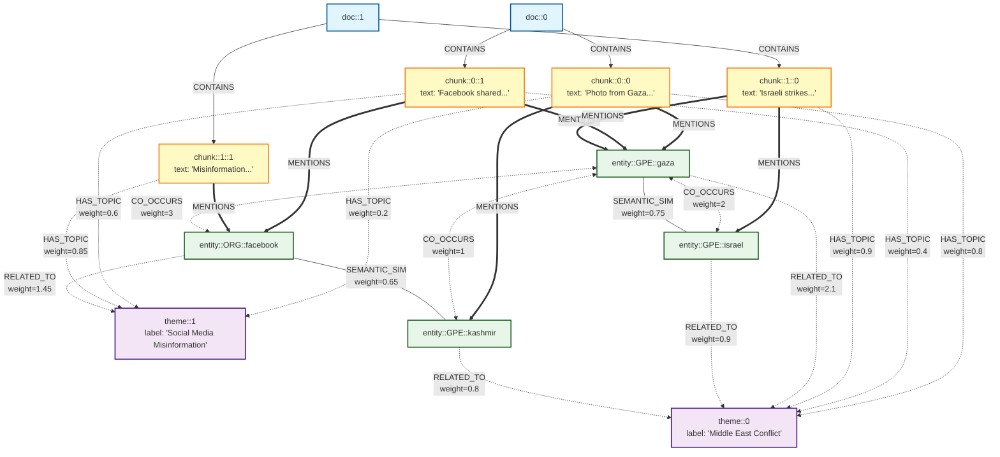

# Architecture Knowledge Graph pour Fact-Checking

## Vue d'ensemble

Ce document décrit l'architecture complète du système de Knowledge Graph multi-niveaux pour le fact-checking, basé sur une approche GraphRAG hybride combinant retrieval sémantique, thématique et par entités.

---

## Structure du Graphe (3 niveaux)



**Légende :**
- 🔵 **Documents** : Sources originales (fact-checks)
- 🟡 **Chunks** : Fragments de texte avec overlap
- 🟣 **Thèmes** : Topics extraits par BERTopic + labelisés par LLM
- 🟢 **Entités** : Named entities extraites par spaCy NER

**Types d'arêtes :**
- `CONTAINS` : Document → Chunk (hiérarchie)
- `HAS_TOPIC` : Chunk → Thème (probabilité BERTopic)
- `MENTIONS` : Chunk → Entité (présence)
- `RELATED_TO` : Entité ↔ Thème (via chunks intermédiaires)
- `CO_OCCURS` : Entité ↔ Entité (fréquence co-apparition)
- `SEMANTIC_SIM` : Entité ↔ Entité (similarité embeddings)

---

## Construction du Graphe

### Étape 1 : Documents → Chunks

```python
# Chunking avec overlap
chunk_size = 500 caractères
overlap = 100 caractères

# Arêtes créées
doc::id ──CONTAINS──> chunk::id::0
doc::id ──CONTAINS──> chunk::id::1
...
```

**Usage :** Retrouver le document source final uniquement (pas utilisé dans retrieval)

---

### Étape 2 : Topic Modeling → Thèmes

**Méthode :** BERTopic avec `all-MiniLM-L6-v2`

```python
# 1. Entraîner BERTopic sur tous les chunks
topic_model = BERTopic(embedding_model='all-MiniLM-L6-v2')
topics, probs = topic_model.fit_transform(chunk_texts)

# 2. Pour chaque topic, extraire mots représentatifs
top_words = topic_model.get_topic(topic_id)

# 3. Labelliser avec Llama (local)
prompt = f"Summarize this topic in 3-5 words: {top_words}"
label = llama.generate(prompt)

# 4. Créer nœuds thèmes
theme::topic_id avec attributs:
  - label: str (ex: "Middle East Conflict")
  - keywords: list (mots représentatifs)

# 5. Créer arêtes pondérées
chunk::id ──HAS_TOPIC(weight=p)──> theme::topic_id
  où p = probabilité du topic dans le chunk
```

---

### Étape 3 : Extraction d'Entités

**Méthode :** spaCy NER (`en_core_web_sm`)

```python
# 1. Pour chaque chunk, extraire entités
nlp = spacy.load("en_core_web_sm")
doc = nlp(chunk_text)

# 2. Filtrer types pertinents
types = ['PERSON', 'ORG', 'GPE', 'LOC', 'DATE', 'EVENT', 'NORP']

# 3. Créer nœuds entités
entity::type::name avec attributs:
  - entity_type: str (PERSON, ORG, etc.)
  - entity_text: str (nom normalisé)

# 4. Arêtes Chunk → Entité
chunk::id ──MENTIONS──> entity::type::name
```

---

### Étape 4 : Relations Entités ↔ Thèmes

**Calcul via chunks intermédiaires :**

```python
# Pour chaque paire (entity, theme)
weight = 0
for chunk in chunks_mentioning_entity:
    if chunk has HAS_TOPIC edge to theme:
        weight += chunk_theme_probability

# Créer arête si weight > seuil
entity::name ──RELATED_TO(weight=w)──> theme::id
```

**Exemple :**
- `entity::Gaza` apparaît dans chunk_1 (theme_conflict=0.8) et chunk_2 (theme_conflict=0.7)
- → `entity::Gaza ──RELATED_TO(weight=1.5)──> theme::conflict`

---

### Étape 5 : Relations entre Entités

**5a. Co-occurrence**

```python
# Compter apparitions conjointes
for chunk in all_chunks:
    entities_in_chunk = get_entities(chunk)
    for (e1, e2) in combinations(entities_in_chunk, 2):
        co_occur_count[(e1, e2)] += 1

# Créer arêtes si count > seuil
entity::e1 ──CO_OCCURS(weight=n)──> entity::e2
```

**5b. Similarité sémantique**

```python
# Embedder chaque entité (nom seul)
entity_embeddings = model.encode([e.text for e in entities])

# Calculer similarité cosinus
for (e1, e2) in combinations(entities, 2):
    sim = cosine_similarity(emb[e1], emb[e2])
    if sim > threshold:
        entity::e1 ──SEMANTIC_SIM(weight=sim)──> entity::e2
```

---

## Stratégie de Retrieval (3 étapes parallèles)

### Input : Claim à vérifier

Exemple : *"Photo from Gaza 2008 shared on Facebook claiming Kashmir violence"*

---

### Étape 1 : Retrieval Sémantique

**Objectif :** Trouver chunks sémantiquement similaires au claim

```python
# 1. Embedder le claim
claim_embedding = model.encode(claim)

# 2. Calculer similarité avec tous les chunks
for chunk in all_chunks:
    chunk_embedding = get_chunk_embedding(chunk)
    score_sem = cosine_similarity(claim_embedding, chunk_embedding)

# 3. Top-K chunks
S1 = top_k_chunks_by_semantic_score

# Normalisation min-max
scores_normalized = (scores - min) / (max - min)
```

**Output :** `S₁ = {(chunk_i, score_sem_i)}`

---

### Étape 2 : Retrieval Thématique

**Objectif :** Explorer le graphe via les thèmes du claim

```python
# 1. Classifier le claim dans les topics existants
topic_probs = topic_model.transform([claim])
# → [0.7, 0.1, 0.2] sur 3 topics

# 2. Pour chaque topic avec confiance > seuil
detected_themes = [(theme_id, prob) for theme_id, prob in enumerate(topic_probs) if prob > 0.1]

# 3. Pour chaque thème détecté
S2 = {}
for (theme_id, confidence_claim) in detected_themes:
    # Trouver chunks liés à ce thème
    chunks = graph.neighbors(f"theme::{theme_id}", edge_type="HAS_TOPIC")

    for chunk, prob_chunk in chunks:
        # Score = confiance claim × probabilité chunk
        score_theme = confidence_claim × prob_chunk

        # Accumuler si le chunk a plusieurs thèmes en commun
        S2[chunk] = S2.get(chunk, 0) + score_theme

# Normalisation
scores_normalized = (scores - min) / (max - min)
```

**Output :** `S₂ = {(chunk_k, score_theme_k)}`

---

### Étape 3 : Retrieval par Entités

**Objectif :** Parcourir le graphe via les entités du claim

```python
# 1. Extraire entités du claim
entities_claim = extract_entities(claim, nlp)
# → ["Gaza", "Facebook", "Kashmir", "2008"]

# 2. Pour chaque entité
S3 = {}
for entity in entities_claim:

    # PATH 1 : Direct (chunk MENTIONS entity)
    chunks_direct = graph.neighbors(f"entity::{entity}", edge_type="MENTIONS")
    for chunk in chunks_direct:
        S3[chunk] = max(S3.get(chunk, 0), 1.0)

    # PATH 2 : Via co-occurrence
    co_entities = graph.neighbors(f"entity::{entity}", edge_type="CO_OCCURS")
    for co_entity, weight_co in co_entities:
        chunks_via_co = graph.neighbors(co_entity, edge_type="MENTIONS")
        for chunk in chunks_via_co:
            score = (weight_co / max_co_occur) × 0.8  # Pénalité 2-hops
            S3[chunk] = max(S3.get(chunk, 0), score)

    # PATH 3 : Via thèmes
    related_themes = graph.neighbors(f"entity::{entity}", edge_type="RELATED_TO")
    for theme, weight_rel in related_themes:
        chunks_via_theme = graph.neighbors(theme, edge_type="HAS_TOPIC")
        for chunk, prob_theme in chunks_via_theme:
            score = (weight_rel × prob_theme) × 0.6  # Pénalité 3-hops
            S3[chunk] = max(S3.get(chunk, 0), score)

# Normalisation
scores_normalized = (scores - min) / (max - min)
```

**Output :** `S₃ = {(chunk_p, score_entity_p)}`

---

### Fusion des Scores

```python
# Paramètres (variables optionnelles)
alpha = 0.4  # Poids sémantique
beta = 0.3   # Poids thématique
gamma = 0.3  # Poids entités

# Pour chaque chunk dans S₁ ∪ S₂ ∪ S₃
all_chunks = set(S1.keys()) | set(S2.keys()) | set(S3.keys())

final_results = []
for chunk in all_chunks:
    score_sem = S1.get(chunk, 0)
    score_theme = S2.get(chunk, 0)
    score_entity = S3.get(chunk, 0)

    # Score final pondéré
    final_score = alpha × score_sem + beta × score_theme + gamma × score_entity

    # Retrouver le document source
    doc_id = get_document_of_chunk(chunk)

    final_results.append({
        'chunk': chunk,
        'doc': doc_id,
        'score_total': final_score,
        'score_sem': score_sem,
        'score_theme': score_theme,
        'score_entity': score_entity
    })

# Trier par score décroissant
final_results.sort(key=lambda x: x['score_total'], reverse=True)
```

**Output final :**

```
Top-5 chunks pour le claim:
1. chunk::0::1 (score=0.92) → doc::0
   - Semantic: 0.85, Thematic: 0.95, Entity: 1.0

2. chunk::0::3 (score=0.87) → doc::0
   - Semantic: 0.80, Thematic: 0.90, Entity: 0.95

3. chunk::42::2 (score=0.78) → doc::42
   - Semantic: 0.75, Thematic: 0.85, Entity: 0.75

...
```

---

## Paramètres du Système

### Construction du Graphe

| Paramètre | Valeur | Description |
|-----------|--------|-------------|
| `chunk_size` | 500 | Taille chunk en caractères |
| `chunk_overlap` | 100 | Overlap entre chunks |
| `embedding_model` | `all-MiniLM-L6-v2` | Modèle SentenceTransformer |
| `ner_model` | `en_core_web_sm` | Modèle spaCy NER |
| `topic_model` | BERTopic | Méthode topic modeling |
| `llm_labeling` | Llama (local) | LLM pour labeling topics |
| `entity_types` | PERSON, ORG, GPE, LOC, DATE, EVENT, NORP | Types d'entités |

### Retrieval

| Paramètre | Valeur | Description |
|-----------|--------|-------------|
| `alpha` | 0.4 | Poids score sémantique |
| `beta` | 0.3 | Poids score thématique |
| `gamma` | 0.3 | Poids score entités |
| `top_k` | 10 | Nombre de chunks retournés |
| `theme_threshold` | 0.1 | Seuil confiance thème |
| `co_occur_threshold` | 2 | Seuil co-occurrence |
| `semantic_sim_threshold` | 0.6 | Seuil similarité entités |

---

## Avantages de cette Architecture

### 1. Robustesse multi-niveaux
- Si le claim est mal formulé → retrieval sémantique rattrape
- Si les mots sont différents mais thème similaire → retrieval thématique trouve
- Si noms propres précis → retrieval par entités ultra-précis

### 2. Explicabilité
Chaque chunk retourné vient avec :
- Score de chaque dimension (sémantique, thématique, entités)
- Chemin dans le graphe (via quelles entités/thèmes trouvé)
- Document source pour vérification

### 3. Découverte de contexte
- Via co-occurrence : trouve entités liées non mentionnées dans le claim
- Via thèmes : trouve contexte thématique élargi
- Via chemins graphe : explique les relations

### 4. Précision pour fact-checking
- Entités (noms, dates, lieux) → matches exacts
- Thèmes → vérification contexte cohérent
- Sémantique → flexible sur formulation

---

## Exemple Complet de Retrieval

**Claim :** *"Photo from Gaza 2008 shared on Facebook claiming Kashmir violence"*

### Étape 1 : Sémantique
```
Top-3 chunks similaires:
- chunk::0::1 (0.85): "A photo from Gaza was shared on Facebook..."
- chunk::15::2 (0.78): "Old Gaza images misattributed to Kashmir..."
- chunk::42::0 (0.72): "Social media spreads conflict photos..."
```

### Étape 2 : Thématique
```
Thèmes détectés dans le claim:
- theme::1 "Social Media Misinformation" (conf=0.7)
- theme::3 "Middle East Conflict" (conf=0.6)

Chunks via theme::1:
- chunk::0::1 (0.7 × 0.85 = 0.595)
- chunk::8::3 (0.7 × 0.75 = 0.525)

Chunks via theme::3:
- chunk::0::1 (0.6 × 0.80 = 0.480)
- chunk::15::2 (0.6 × 0.90 = 0.540)
```

### Étape 3 : Entités
```
Entités extraites: Gaza, Facebook, Kashmir, 2008

Via entity::Gaza:
- chunk::0::1 (direct, 1.0)
- chunk::15::2 (direct, 1.0)
- chunk::42::5 (via co-occur Israel, 0.8)

Via entity::Facebook:
- chunk::0::1 (direct, 1.0)
- chunk::8::3 (direct, 1.0)

Via entity::Kashmir:
- chunk::0::1 (direct, 1.0)
- chunk::15::2 (direct, 1.0)
```

### Fusion
```
chunk::0::1:
  sem=0.85, theme=0.595+0.480=1.075 (normalisé→0.92), entity=1.0
  final = 0.4×0.85 + 0.3×0.92 + 0.3×1.0 = 0.916 ✓

chunk::15::2:
  sem=0.78, theme=0.540, entity=1.0
  final = 0.4×0.78 + 0.3×0.54 + 0.3×1.0 = 0.774

→ Résultat : chunk::0::1 est le plus pertinent (doc::0)
```

---

## Fichiers du Projet

```
graphRAG/
├── knowledge_graph.py          # Construction du graphe 3-niveaux
├── graph_search_kg.py          # Retrieval hybride (3 étapes)
├── graph_visualisation_kg.py   # Visualisation multi-types
└── ARCHITECTURE.md             # Ce document
```

---

## Références Techniques

- **BERTopic** : https://maartengr.github.io/BERTopic/
- **SentenceTransformers** : https://www.sbert.net/
- **spaCy NER** : https://spacy.io/usage/linguistic-features#named-entities
- **NetworkX** : https://networkx.org/
- **Llama** : https://github.com/facebookresearch/llama

---

*Document créé le 2025-11-05*
