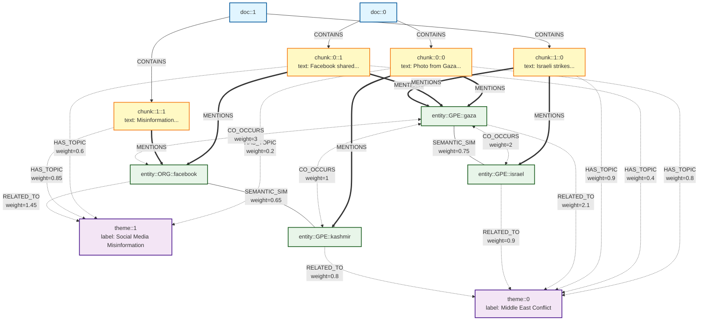

# Architecture Knowledge Graph pour Fact-Checking

## Vue d'ensemble

Ce document décrit l'architecture complète du système de Knowledge Graph multi-niveaux pour le fact-checking, basé sur une approche GraphRAG hybride combinant retrieval sémantique, thématique et par entités.

---

## Structure du Graphe (3 niveaux)



**Légende :**
- 🔵 **Documents** : Sources originales (fact-checks)
- 🟡 **Chunks** : Fragments de texte avec overlap
- 🟣 **Thèmes** : Topics extraits par BERTopic + labelisés
- 🟢 **Entités** : Named entities extraites par spaCy NER

---

## Organisation des fichiers

```
PRL/
├── fact_check_kg/                          # Module principal
│   ├── __init__.py                         # Initialisation module
│   ├── config.py                           # Configuration (GraphConfig, RetrievalConfig)
│   ├── data_loader.py                      # Chargement CSV + chunking
│   ├── graph_builder.py                    # Construction du graphe
│   ├── retrieval.py                        # Système de retrieval hybride
│   ├── build_graph.py                      # Script CLI pour construire le graphe
│   ├── test_retrieval.py                   # Script CLI pour tester le retrieval
│   ├── README.md                           # Documentation détaillée du module
│   ├── knowledge_graph.gpickle             # Graphe généré (après build)
│   └── knowledge_graph_topic_model.pkl     # Modèle BERTopic (après build)
├── ARCHITECTURE.md                         # Ce fichier (vue d'ensemble)
└── data/
    └── english_fact_checks.csv             # Données sources
```

---

## Utilisation

### 1. Construction du graphe

```bash
cd fact_check_kg

# Construction avec 50 documents (test)
uv run python build_graph.py --max-docs 50

# Construction avec plus de documents
uv run python build_graph.py --max-docs 500 --chunk-size 500 --chunk-overlap 100
```

### 2. Test du retrieval

```bash
# Test avec claim personnalisé
uv run python test_retrieval.py --claim "Photo from Gaza 2008 shared on Facebook"

# Test avec poids personnalisés (emphase sur les entités)
uv run python test_retrieval.py --claim "Trump met Macron" --alpha 0.2 --beta 0.2 --gamma 0.6
```

---

## Résultats obtenus

### Exemple : "Photo from Gaza 2008 shared on Facebook"

**Top 3 résultats :**

1. **chunk::0::0** (doc::0) - Score: 0.876
   - Sémantique: 1.000 ✓
   - Thématique: 0.588
   - Entités: 1.000 ✓
   - Texte: "This is an 11-year-old photo from Gaza, not from recent violence..."

2. **chunk::0::2** (doc::0) - Score: 0.852
   - Match parfait avec entités Gaza + 2008 + Facebook

3. **chunk::39::0** (doc::39) - Score: 0.834
   - Contexte thématique similaire (photo misinformation)

**Statistiques du graphe (50 documents) :**
- **1728 nœuds** : 50 documents, 406 chunks, 1267 entités, 5 thèmes
- **31000 arêtes** : Toutes relations créées
- Temps de construction : ~22 secondes
- Temps de retrieval : ~4 secondes

---

## Avantages par rapport à RAG classique

| Aspect | RAG classique | GraphRAG (notre système) |
|--------|---------------|--------------------------|
| **Granularité** | Documents entiers | Chunks précis (500 chars) |
| **Reformulation** | ❌ Dépend de la formulation exacte | ✅ Trouve via entités |
| **Dates/Lieux** | ❌ Noyés dans le texte | ✅ Extraction NER explicite |
| **Contexte thématique** | ❌ Pas de liens explicites | ✅ Via BERTopic |
| **Explicabilité** | ❌ "Score: 0.85" | ✅ Décomposition (sem/theme/entity) |
| **Découverte** | ❌ Top-K fixe | ✅ Expansion via graphe |

---

## Paramètres configurables

### Construction du graphe (`GraphConfig`)

```python
chunk_size = 500               # Taille des chunks (caractères)
chunk_overlap = 100            # Overlap entre chunks
embedding_model = "all-MiniLM-L6-v2"
ner_model = "en_core_web_sm"
entity_types = ['PERSON', 'ORG', 'GPE', 'LOC', 'DATE', 'EVENT', 'NORP']
min_topic_size = 10
co_occur_threshold = 2
semantic_sim_threshold = 0.6
entity_related_threshold = 0.5
```

### Retrieval (`RetrievalConfig`)

```python
alpha = 0.4    # Poids sémantique
beta = 0.3     # Poids thématique
gamma = 0.3    # Poids entités
top_k = 10
theme_threshold = 0.1
```

---

## Stratégie de retrieval détaillée

### Étape 1 : Retrieval sémantique
- Embedder le claim
- Calculer similarité cosinus avec tous les chunks
- Normalisation min-max

### Étape 2 : Retrieval thématique
- Classifier le claim avec BERTopic
- Pour chaque thème détecté (confiance > 0.1) :
  - Trouver chunks liés via HAS_TOPIC
  - Score = confiance_claim × probabilité_chunk

### Étape 3 : Retrieval par entités
- Extraire entités du claim (spaCy NER)
- 3 chemins d'exploration :
  1. **Direct** : entity → MENTIONS → chunk (score = 1.0)
  2. **Co-occurrence** : entity → CO_OCCURS → entity2 → chunk (score = w × 0.8)
  3. **Via thème** : entity → RELATED_TO → theme → chunk (score = w×p × 0.6)

### Fusion finale
```
score_final = α × score_sémantique + β × score_thématique + γ × score_entités
```

---

## Améliorations futures

- [ ] Intégration Llama pour labeling des thèmes (via ollama)
- [ ] Vérification cohérence temporelle (dates contradictoires)
- [ ] Détection de contradictions entre chunks
- [ ] Visualisation interactive du graphe
- [ ] Explication des chemins de retrieval
- [ ] Optimisation avec FAISS pour embeddings
- [ ] Support multi-langues
- [ ] API REST pour interrogation

---

## Dépendances

```toml
[dependencies]
networkx
sentence-transformers
bertopic
keybert
spacy
numpy
pandas
scikit-learn
pyvis
```

---

## Contact

Pour questions ou suggestions, contactez l'équipe de développement.

---

*Document créé le 2025-11-05*
